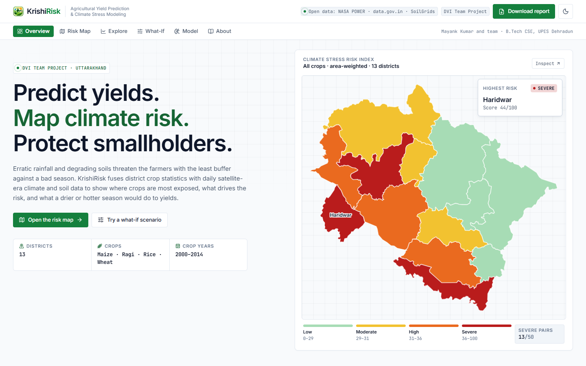
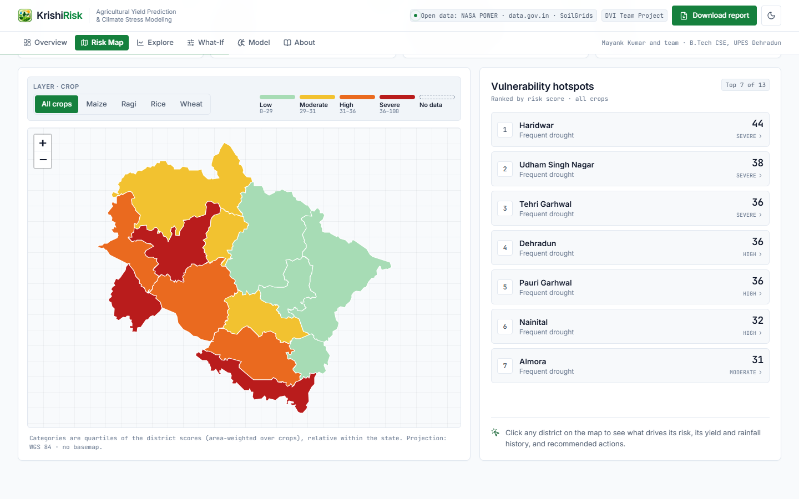
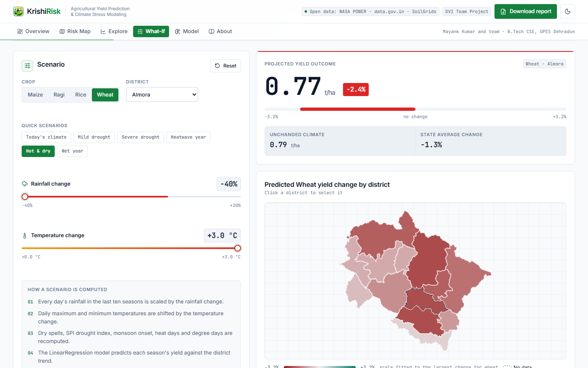
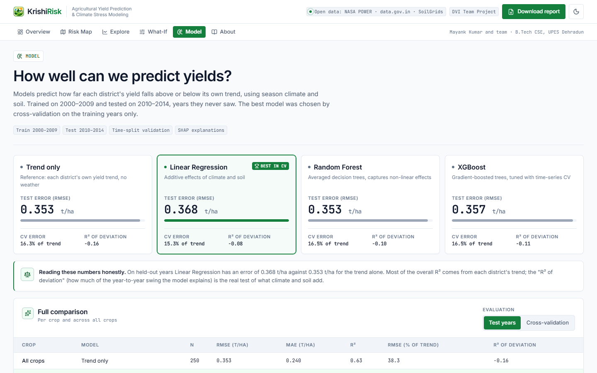
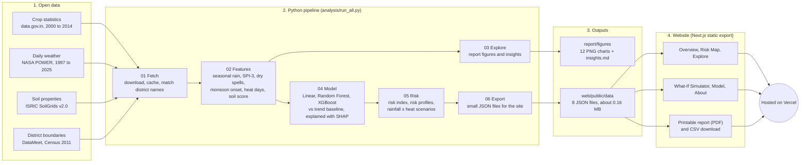

<p align="center">
  
</p>

<h1 align="center">KrishiRisk</h1>
<p align="center"><b>Agricultural Yield Prediction & Climate Stress Modeling</b><br/>
<i>Predict yields. Map climate risk. Protect smallholders.</i></p>

<p align="center">
  <b>Live demo:</b> <a href="https://krishirisk.vercel.app">krishirisk.vercel.app</a> <i>(link is active)</i>
</p>

Data Visualization &amp; Interpretation (DVI) team project by **Mayank Kumar and team**, B.Tech CSE, UPES Dehradun.

---

## Problem

Unpredictable rainfall and soil degradation threaten the yields of smallholder farmers, who have the least
buffer against a bad season. KrishiRisk turns open crop, climate and soil data into **district-level yield
models and climate-risk assessments** for **Uttarakhand** (13 districts; maize, ragi, rice and wheat):

- Which districts and crops are most exposed to climate stress, and **why**?
- How strongly do rainfall, drought, heat and soil actually move yields?
- What would a drier or hotter season do to yields?

## Screenshots

| Overview | Risk Map |
|:---:|:---:|
|  |  |
| **What-If Simulator** | **Model** |
|  |  |

Report figures (300 dpi) are in [`report/figures/`](report/figures/), with computed interpretations in
[`report/figures/insights.md`](report/figures/insights.md).

## Website

| Page                        | What it shows                                                                                         |
| --------------------------- | ----------------------------------------------------------------------------------------------------- |
| **Overview**          | Headline numbers, the state risk map and six key findings                                             |
| **Risk Map**          | Interactive district map by crop, hotspot ranking, district profiles with yield, rainfall and actions |
| **Explore**           | Yield trends, rainfall vs yield, yield anomaly by rainfall category, climate correlation heatmap      |
| **What-If Simulator** | Rainfall and temperature sliders with quick scenarios, predicted yield change by district             |
| **Model**             | Model comparison against the trend baseline, SHAP feature importance, actual vs predicted             |
| **About**             | Data sources, method and limitations                                                                  |
| **Report**            | Printable climate risk report (save as PDF) and CSV download of the district risk table               |

The site has light and dark themes and works on phones.

## Architecture



```
analysis/            Python pipeline: 01_fetch_data.py ... 06_export_web.py, run_all.py
  config.py          scope (state, crops, years) and source settings
  climate.py         season climate features shared by 02 (history) and 05 (scenarios)
data/raw/            downloads and caches (not committed)
data/processed/      cleaned tables, model metrics, risk index, scenarios
report/figures/      report figures (PNG) and insights.md
web/                 Next.js (App Router, TypeScript, Tailwind), reads only web/public/data/*.json
  src/app/           pages: overview, risk-map, explore, simulator, model, about, report
  src/components/    shared UI, charts (Recharts), maps (Leaflet and SVG)
assets/brand/        logo and favicon sources
docs/screenshots/    README screenshots
```

## Datasets

| Data                                                                                             | Source                                                                                                                                                                                                                             | Used for               | Licence                               |
| ------------------------------------------------------------------------------------------------ | ---------------------------------------------------------------------------------------------------------------------------------------------------------------------------------------------------------------------------------- | ---------------------- | ------------------------------------- |
| District-wise, season-wise crop production statistics (area, production), Uttarakhand 2000–2014 | Directorate of Economics &amp; Statistics, Ministry of Agriculture &amp; Farmers Welfare, via the [Open Government Data Platform India](https://www.data.gov.in/resource/district-wise-season-wise-crop-production-statistics-1997) | yields (t/ha)          | Government Open Data License – India |
| Daily precipitation, Tmax, Tmin, relative humidity at district centroids, 1997–2025             | [NASA POWER](https://power.larc.nasa.gov/) daily point API (v2)                                                                                                                                                                     | all climate features   | NASA open data                        |
| Organic carbon, pH, nitrogen, sand/silt/clay (0–30 cm)                                          | [ISRIC SoilGrids v2.0](https://www.isric.org/explore/soilgrids)                                                                                                                                                                     | soil degradation score | CC BY 4.0                             |
| Census 2011 district boundaries                                                                  | [DataMeet community maps](https://github.com/datameet/maps)                                                                                                                                                                         | maps, centroids        | see repository                        |

**Citations**

- NASA POWER: *These data were obtained from the NASA Langley Research Center (LaRC) POWER Project funded through the NASA Earth Science/Applied Science Program.*
- Poggio, L., de Sousa, L. M., Batjes, N. H., Heuvelink, G. B. M., Kempen, B., Ribeiro, E. &amp; Rossiter, D. (2021). SoilGrids 2.0: producing soil information for the globe with quantified spatial uncertainty. *SOIL*, 7, 217–240. https://doi.org/10.5194/soil-7-217-2021
- McKee, T. B., Doesken, N. J. &amp; Kleist, J. (1993). The relationship of drought frequency and duration to time scales. *Proc. 8th Conference on Applied Climatology*, 179–184. *(SPI)*
- Sivakumar, M. V. K. (1988). Predicting rainy season potential from the onset of rains in Southern Sahelian and Sudanian climatic zones of West Africa. *Agricultural and Forest Meteorology*, 42(4), 295–305. *(monsoon onset definition)*
- Lundberg, S. M. &amp; Lee, S.-I. (2017). A Unified Approach to Interpreting Model Predictions. *NeurIPS 30*. *(SHAP)*

## Methodology

1. **Clean &amp; join**: units normalised (bales → tonnes), impossible yields removed, IQR outliers flagged (kept),
   district names matched to the map (fuzzy match + manual review; current official names such as Haridwar and
   Pauri Garhwal). Nothing is imputed: missing values stay missing and every gap is reported.
2. **Season climate features** (Kharif = Jun–Oct, Rabi = Nov–Mar): seasonal rainfall and its z-score anomaly,
   SPI-3 (gamma-fitted per district and month), dry spells (≥ 7 days &lt; 2.5 mm), monsoon onset delay,
   weekly rainfall CV, heat-stress days (Tmax &gt; 35 °C), growing degree days (base 10 °C), mean Tmax/Tmin.
3. **Soil Degradation Score (0–1)**: min-max scaled low organic carbon (weight 0.30), |pH − 6.5| (0.20) and
   low nitrogen (0.20); weights rescaled because SoilGrids has no P or K.
4. **Models**: target is the yield deviation from each district-crop trend, with the trend fitted on
   training years only (no leakage). **Time-based split**: train 2000–2009, test 2010–2014. Linear Regression,
   Random Forest and XGBoost (light grid search with expanding-window CV), compared against a **trend-only
   baseline**; the best model is chosen by grouped CV by year, never by the test set. SHAP explains the model.
5. **Climate Stress Risk Index (0–100)** per district × crop, rainfall variability, drought frequency
   (SPI-3 &lt; −1), heat stress, soil degradation and yield volatility, weighted by mean |SHAP|
   (0.33 / 0.32 / 0.14 / 0.01, yield volatility fixed at 0.20). Quartile categories (Low → Severe);
   K-means (k by silhouette) groups districts into risk profiles.
6. **Scenarios**: rainfall −40 % … +20 % × temperature +0 … +3 °C (91 combinations): the observed daily
   climate of 2005–2014 is perturbed, every feature is recomputed, and the model predicts the yield change.

## Key findings

All numbers come from the pipeline outputs ([`insights.md`](report/figures/insights.md),
[`model_metrics.md`](data/processed/model_metrics.md)).

- **Haridwar is the most climate-stressed district** (risk 44/100, Severe), followed by Udham Singh Nagar (38)
  and Tehri Garhwal (36). Haridwar, Udham Singh Nagar and Nainital form a *heat-exposed & degraded soils* profile.
- **Wheat carries the highest climate stress**: average risk 54/100, and all 13 Severe district-crop pairs are wheat.
- **The monsoon dominates**: 79.2 % of annual rain falls June–September (July is wettest, 323 mm on average);
  drought-level seasons (SPI-3 &lt; −1) occurred in 16.7 % of district-seasons.
- **Uneven rain hurts most**: weekly rainfall variability is the strongest correlate of wheat yield anomalies
  (r = −0.56, p &lt; 0.001); 24 of 59 feature × crop correlations are significant at p &lt; 0.05. In rainfall-deficit
  seasons median wheat yield ran −2.8 % below trend versus +2.8 % in normal seasons (Kruskal–Wallis p &lt; 0.001).
- **Yields still rose** 1.0–1.9 % per year (2000–2014); maize fastest (+1.9 %/yr).
- **Honest model result**: weather and soil add only modest skill beyond each district's trend. Linear Regression
  won cross-validation (error 15.3 % vs 16.3 % of trend yield for the trend-only baseline) but on the unseen
  2010–2014 years it did not beat the baseline (RMSE 0.368 vs 0.353 t/ha). Consequently simulated impacts are small:
  −0.4 % state-wide for −20 % rainfall; the largest drop is −2.5 % (Chamoli wheat, −40 % rain and +3 °C).

### Model metrics (all crops)

| Model                                    | CV error (% of trend yield) | CV R² of deviation | Test RMSE (t/ha) | Test MAE (t/ha) | Test R² | Test R² of deviation |
| ---------------------------------------- | --------------------------- | ------------------- | ---------------- | --------------- | -------- | --------------------- |
| Trend only (baseline)                    | 16.3                        | 0.00                | 0.353            | 0.240           | 0.63     | −0.16                |
| **Linear Regression** (best in CV) | **15.3**              | **0.12**      | 0.368            | 0.245           | 0.60     | −0.08                |
| Random Forest                            | 16.5                        | −0.02              | 0.353            | 0.240           | 0.64     | −0.11                |
| XGBoost                                  | 16.5                        | −0.03              | 0.357            | 0.240           | 0.63     | −0.11                |

CV = grouped by year on 2000–2009; test = 2010–2014. "R² of deviation" measures how much of the year-to-year
swing around the trend a model explains, the honest test of what climate and soil add. Per-crop results are in
[`data/processed/model_metrics.md`](data/processed/model_metrics.md).

## How to reproduce

Requirements: Python 3.11+, Node.js 20+.

```bash
# 1. Python environment
python -m venv .venv
# Windows: .venv\Scripts\activate    macOS/Linux: source .venv/bin/activate
pip install -r requirements.txt

# 2. Crop data (one of):
#    a) put a free data.gov.in API key in a .env file at the repo root:  DATA_GOV_IN_API_KEY=your_key
#    b) or download the CSV from data.gov.in into data/raw/crop/ (see analysis/01_fetch_data.py)

# 3. Run the whole pipeline (≈ 6 minutes; downloads are cached)
python analysis/run_all.py          # resume from a step with: python analysis/run_all.py --from 4

# 4. Website
cd web
npm install
npm run dev                         # http://localhost:3000
npm run build                       # static export to web/out/
```

Scope (state, crops, years) is set in [`analysis/config.py`](analysis/config.py).

## Deployment

The site is a fully static Next.js export (`output: "export"`), so it needs no server. On Vercel: import the
repository, set **Root Directory = `web`**, keep the Next.js framework preset and its default build settings.
The data files in `web/public/data/` are committed, so the deployment does not run the Python pipeline.

## Limitations

- Crop statistics for Uttarakhand in this dataset end in 2014, so models learn from only 10 training years.
- District boundaries are Census 2011; climate is sampled at one point per district (its centroid).
- SoilGrids has no phosphorus or potassium; the soil score uses organic carbon, pH and nitrogen only.
- The risk index and its categories are relative within the state (quartiles), not absolute thresholds.
- District-years are not independent, so p-values overstate certainty; correlations are not causal effects.
- Scenarios cannot capture adaptation, irrigation changes or new varieties, and a linear model extrapolates
  straight-line effects beyond the observed climate.

## Future work

- Extend yields beyond 2014 with the DES Area-Production-Yield reports and add more states.
- Use gridded, area-averaged climate (e.g. IMD gridded rainfall) instead of centroid points.
- Add Soil Health Card P/K data and irrigation coverage as features.
- Spatial cross-validation and probabilistic (interval) yield forecasts.
- Seasonal-forecast-driven early warnings on the dashboard.

## License

Code: [MIT](LICENSE) © 2026 Mayank Kumar and team. Datasets remain under their own licences (see *Datasets*).
