# KrishiRisk - EDA insights

Generated by `analysis/03_eda.py` from `data/processed/master.csv`; every number below is computed, not written by hand.

Crops plotted: Wheat, Rice, Ragi, Maize.

> Caution: district-years are not independent (neighbouring districts share weather), so p-values overstate certainty. Correlation is not causation.

## 1. 4 of 4 crops show a significant upward yield trend; Maize rose fastest (+1.9%/yr)

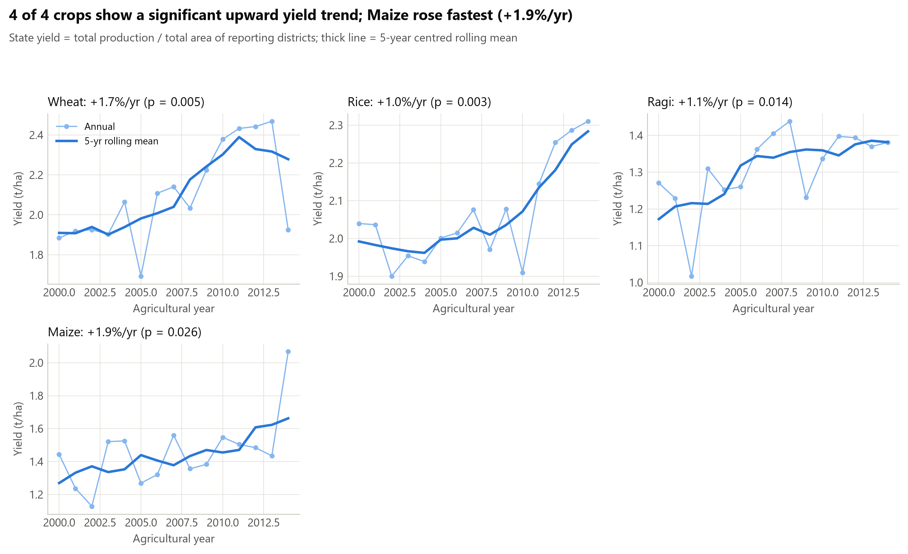

- Wheat: 1.88 -> 1.93 t/ha (2000-2014), linear trend +1.73%/yr of mean yield (p = 0.005).
- Rice: 2.04 -> 2.31 t/ha (2000-2014), linear trend +1.03%/yr of mean yield (p = 0.003).
- Ragi: 1.27 -> 1.38 t/ha (2000-2014), linear trend +1.12%/yr of mean yield (p = 0.014).
- Maize: 1.44 -> 2.07 t/ha (2000-2014), linear trend +1.87%/yr of mean yield (p = 0.026).

## 2. Seasonal rainfall explains little of yield across district-years; strongest link: Rice (r = 0.16)

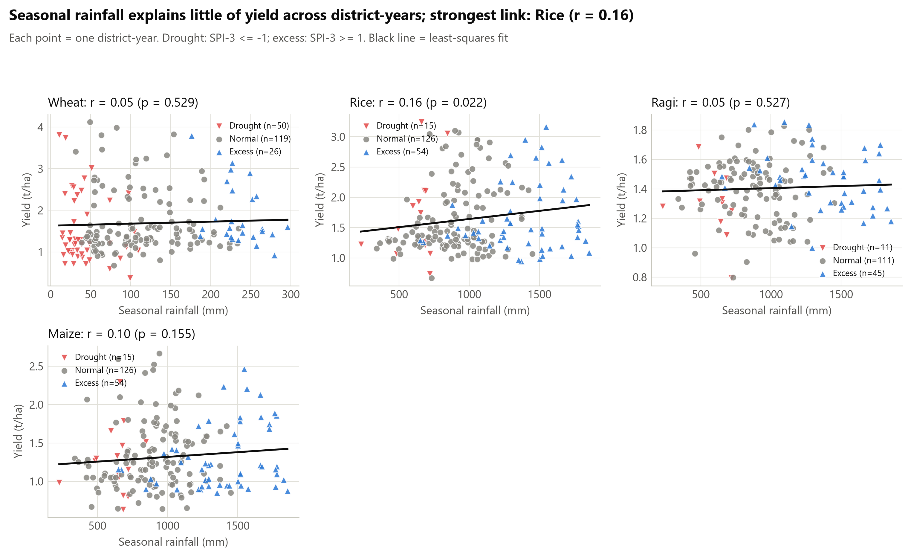

- Wheat: rainfall vs yield r = 0.05 (p = 0.529, n = 195); vs detrended yield anomaly r = 0.24 (p < 0.001). Median yield anomaly: Drought -8.3%, Normal +4.4%, Excess +9.5%.
- Rice: rainfall vs yield r = 0.16 (p = 0.022, n = 195); vs detrended yield anomaly r = -0.04 (p = 0.551). Median yield anomaly: Drought -1.4%, Normal +0.1%, Excess -1.4%.
- Ragi: rainfall vs yield r = 0.05 (p = 0.527, n = 167); vs detrended yield anomaly r = 0.16 (p = 0.040). Median yield anomaly: Drought -4.8%, Normal -1.3%, Excess +2.0%.
- Maize: rainfall vs yield r = 0.10 (p = 0.155, n = 195); vs detrended yield anomaly r = -0.05 (p = 0.465). Median yield anomaly: Drought +0.9%, Normal +0.5%, Excess +2.9%.
- Raw yield mixes districts with very different yield levels; the detrended anomaly correlation isolates the year-to-year rainfall effect.

## 3. Rainfall CV (weekly) is the strongest climate correlate of yield anomaly (Wheat, r = -0.56, p < 0.001)

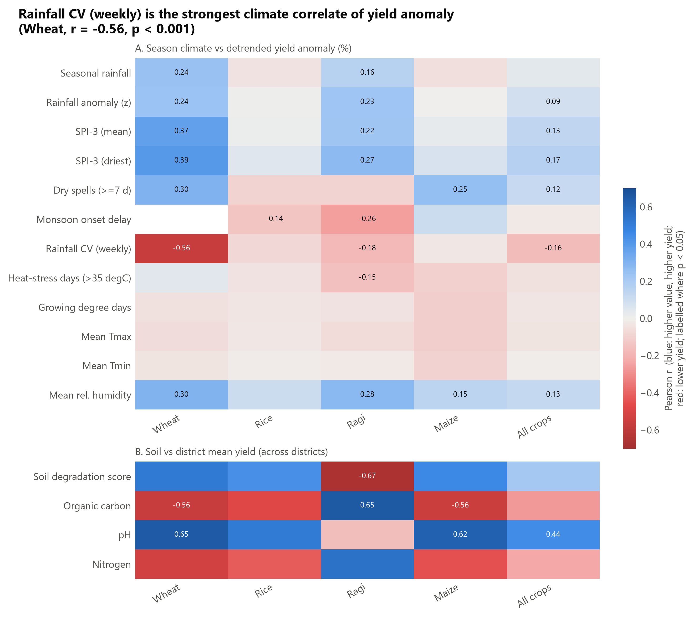

- 24 of 59 climate-feature x crop correlations are significant at p < 0.05.
- Rainfall CV (weekly) - Wheat: r = -0.56 (p < 0.001)
- SPI-3 (driest) - Wheat: r = 0.39 (p < 0.001)
- SPI-3 (mean) - Wheat: r = 0.37 (p < 0.001)
- Dry spells (>=7 d) - Wheat: r = 0.30 (p < 0.001)
- Mean rel. humidity - Wheat: r = 0.30 (p < 0.001)
- Soil: strongest is Soil degradation score vs mean yield for Ragi, r = -0.67 (p = 0.018), computed across districts (small n; treat as indicative).

## 4. Rainfall-deficit years cut yields for 2 of 4 crops; Ragi median -6.0 pts vs normal years

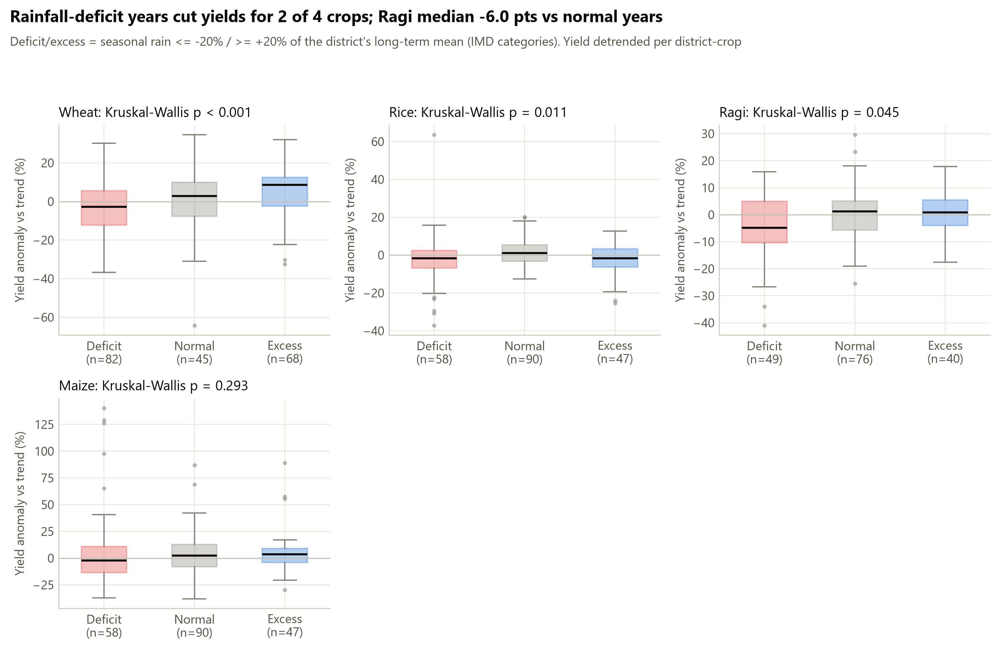

- Wheat: median anomaly deficit -2.8%, normal +2.8%, excess +8.6%; Kruskal-Wallis p < 0.001; deficit vs normal Mann-Whitney p = 0.058.
- Rice: median anomaly deficit -1.7%, normal +1.1%, excess -1.6%; Kruskal-Wallis p = 0.011; deficit vs normal Mann-Whitney p = 0.011.
- Ragi: median anomaly deficit -4.8%, normal +1.2%, excess +0.9%; Kruskal-Wallis p = 0.045; deficit vs normal Mann-Whitney p = 0.031.
- Maize: median anomaly deficit -2.1%, normal +2.5%, excess +3.6%; Kruskal-Wallis p = 0.293; deficit vs normal Mann-Whitney p = 0.211.
- Detrended anomalies are used so district yield levels and technology trends do not mask the rainfall effect.

## 5. The June-September monsoon delivers 79% of annual rainfall

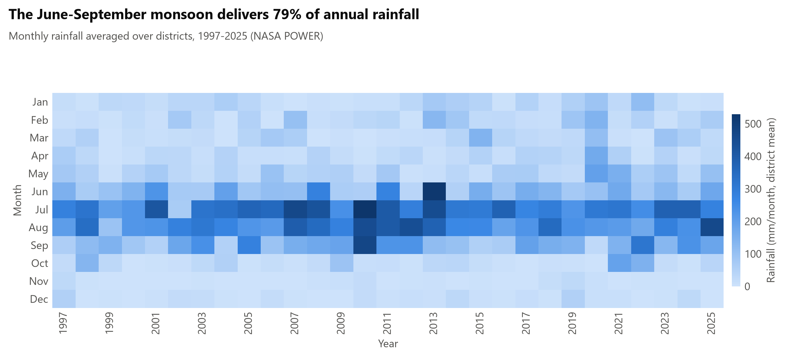

- JJAS share of annual rain: 79.2%; wettest month on average: July (323 mm).
- Annual rain ranged from 601 mm (1999) to 1735 mm (2013); mean 1133 mm, CV 0.21.
- Linear trend in annual rainfall: +10.0 mm/yr (p = 0.063).

## 6. Wheat has the most variable yields (CV = 0.45) across districts and years

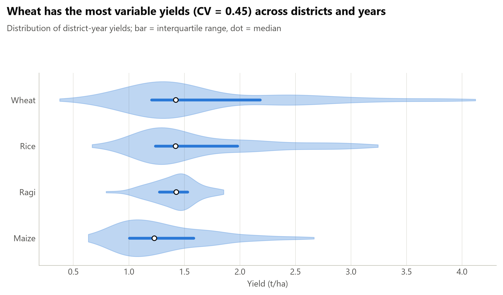

- Wheat: median 1.42 t/ha, IQR 1.20-2.18, CV 0.45, n = 195.
- Rice: median 1.42 t/ha, IQR 1.24-1.98, CV 0.35, n = 195.
- Ragi: median 1.43 t/ha, IQR 1.28-1.53, CV 0.15, n = 167.
- Maize: median 1.23 t/ha, IQR 1.01-1.58, CV 0.32, n = 195.
- Lowest relative variability: Ragi (CV = 0.15).

## 7. Wheat yields are 258% higher in Udham Singh Nagar than in Almora

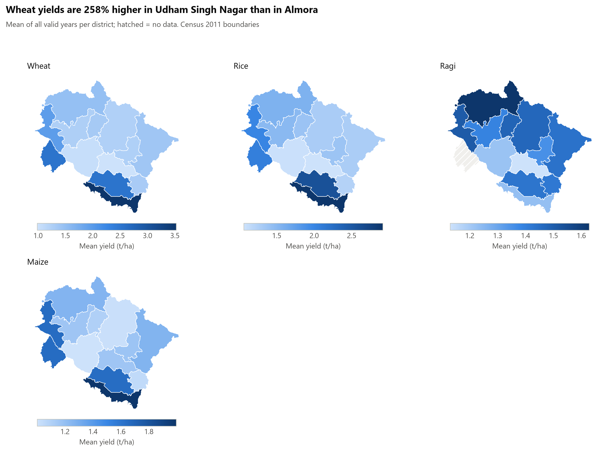

- Wheat: highest Udham Singh Nagar (3.52 t/ha), lowest Almora (0.99 t/ha) - 258% higher; 0 of 13 districts without data.
- Rice: highest Udham Singh Nagar (2.91 t/ha), lowest Almora (1.06 t/ha) - 175% higher; 0 of 13 districts without data.
- Ragi: highest Uttarkashi (1.63 t/ha), lowest Almora (1.13 t/ha) - 44% higher; 1 of 13 districts without data.
- Maize: highest Udham Singh Nagar (2.00 t/ha), lowest Pauri Garhwal (1.00 t/ha) - 99% higher; 0 of 13 districts without data.

## 8. Dry-spell count shows no significant link to yield anomaly (4 crops tested)

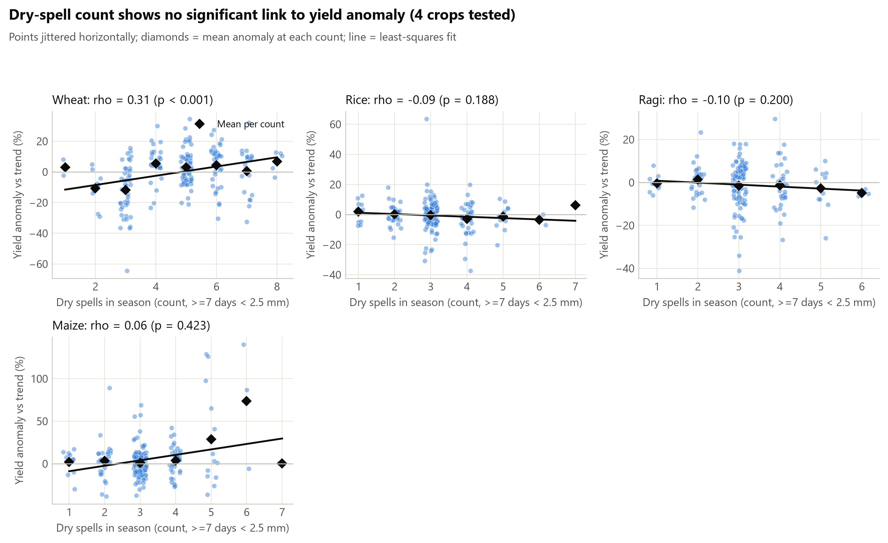

- Wheat: each extra dry spell goes with a +3.0 pt change in yield anomaly (OLS); Spearman rho = 0.31 (p < 0.001), n = 195.
- Rice: each extra dry spell goes with a -0.9 pt change in yield anomaly (OLS); Spearman rho = -0.09 (p = 0.188), n = 195.
- Ragi: each extra dry spell goes with a -0.9 pt change in yield anomaly (OLS); Spearman rho = -0.10 (p = 0.200), n = 165.
- Maize: each extra dry spell goes with a +6.4 pt change in yield anomaly (OLS); Spearman rho = 0.06 (p = 0.423), n = 195.

<!-- model-section:start -->
## Model - LinearRegression

Full table: `data/processed/model_metrics.md`.

- Test years 2010-2014: TrendOnly RMSE 0.353 t/ha, R² 0.63; LinearRegression RMSE 0.368 t/ha, R² 0.60; RandomForest RMSE 0.353 t/ha, R² 0.64; XGBoost RMSE 0.357 t/ha, R² 0.63.
- Best model by grouped CV: LinearRegression. On the deviation from trend it reaches R² -0.08 on test vs 0 for TrendOnly.
- Most of the overall R² on yield comes from the district-crop trend (compare TrendOnly); the 'R² of deviation' column is the honest measure of what weather and soil add.

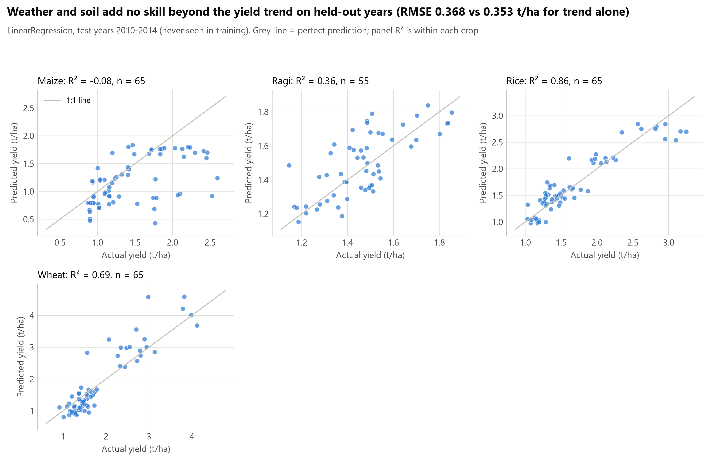

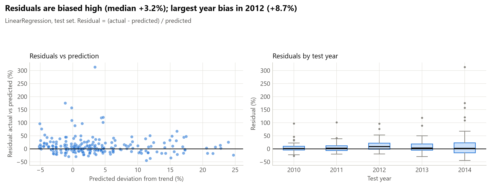

- Median residual +3.2%; the year with the largest median error is 2012 (+8.7%) - a year-wide error points to a state-wide shock the features miss.

### What moves yield (SHAP)

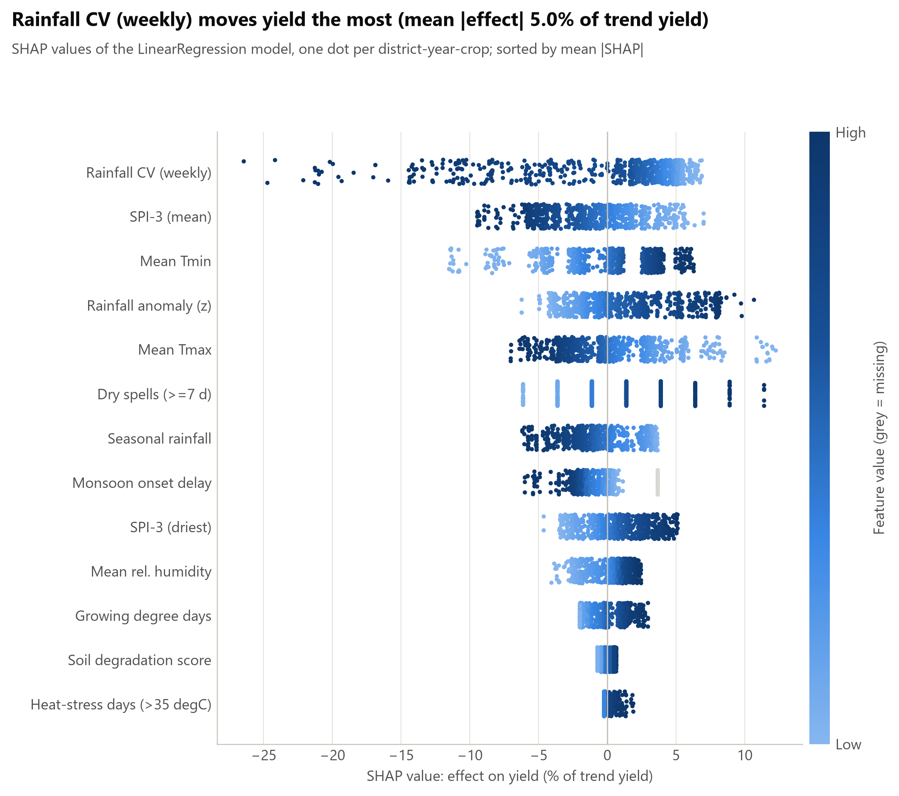

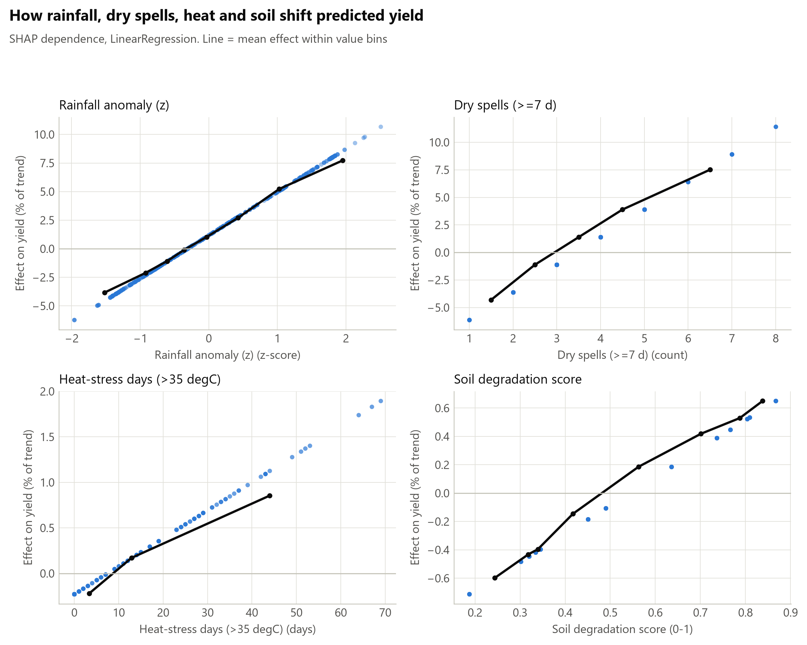

- Mean |SHAP| ranking (percentage points of trend yield): Rainfall CV (weekly) (5.0), SPI-3 (mean) (3.2), Mean Tmin (3.2), Rainfall anomaly (z) (3.0), Mean Tmax (2.9).
- Rainfall CV (weekly): in the top 10% of values (>= 2.24) the model lowers yield by 14.4% of trend on average (high-vs-low difference -20.3 pts).
- Mean Tmin: in the bottom 10% of values (<= 2.11) the model lowers yield by 7.5% of trend on average (high-vs-low difference +12.7 pts).
- SPI-3 (mean): in the top 10% of values (>= 1.34) the model lowers yield by 7.3% of trend on average (high-vs-low difference -12.3 pts).
- Mean Tmax: in the top 10% of values (>= 29.46) the model lowers yield by 5.2% of trend on average (high-vs-low difference -12.8 pts).
- Rainfall anomaly (z): average effect +3.78% of trend yield per +1 SD of rainfall (linear fit to SHAP).
- Dry spells (>=7 d): average effect +2.50% of trend yield per extra dry spell (linear fit to SHAP).
- Heat-stress days (>35 degC): average effect +0.03% of trend yield per extra heat-stress day (linear fit to SHAP).
- Soil degradation score: average effect +0.20% of trend yield per +0.1 of degradation score (linear fit to SHAP).

> SHAP shows how the model uses each feature, not proven causal effects; correlated features (e.g. rainfall, SPI, dry spells) share credit.
<!-- model-section:end -->

<!-- risk-section:start -->
## Climate Stress Risk Index

Index (0-100) = weighted mean of five min-max normalised components: Rainfall variability (inter-annual CV of seasonal rain); Drought frequency (share of seasons with SPI-3 < -1); Heat stress (mean days with Tmax > 35 degC per season); Soil degradation score (0-1, from 02); Yield volatility (std. dev. of detrended yield anomaly, % = CV around trend).

- Weights (shap): Rainfall variability 0.33, Drought frequency 0.31, Heat stress 0.14, Soil degradation score 0.01, Yield volatility 0.20. Basis: mean |SHAP| of each component's model features (LinearRegression), scaled to 80%; yield volatility fixed at 20%.
- Categories are quartiles of the index across 50 district-crop pairs: Low 0.0-10.3, Moderate 10.3-22.6, High 22.6-45.1, Severe 45.1-100.0. The index is relative within the state: 'Severe' = the most stressed quarter.

### Highest-risk district-crop pairs

- Champawat - Wheat: index 60 (Severe); main drivers (normalised): erratic rainfall 0.83, drought-prone 0.80, degraded soils 0.85
- Almora - Wheat: index 60 (Severe); main drivers (normalised): erratic rainfall 0.72, drought-prone 0.80, degraded soils 0.81
- Uttarkashi - Wheat: index 57 (Severe); main drivers (normalised): drought-prone 1.00
- Pauri Garhwal - Wheat: index 57 (Severe); main drivers (normalised): drought-prone 0.80
- Pithoragarh - Wheat: index 56 (Severe); main drivers (normalised): erratic rainfall 1.00

### Risk profiles (K-means)

- k = 2 chosen by silhouette ({2: 0.33, 3: 0.3, 4: 0.31, 5: 0.29, 6: 0.26}).
- Heat-exposed & degraded soils (3 districts: Haridwar, Nainital, Udham Singh Nagar); centroid z-scores erratic rainfall +1.0, drought-prone +0.5, heat-exposed +1.4, degraded soils +1.3, volatile yields -1.2
- Moderate, mixed stress (10 districts: Almora, Bageshwar, Chamoli, Champawat, Dehradun, Pauri Garhwal, Pithoragarh, Rudraprayag, Tehri Garhwal, Uttarkashi); centroid z-scores erratic rainfall -0.3, drought-prone -0.1, heat-exposed -0.4, degraded soils -0.4, volatile yields +0.4

### Climate scenarios

- State average (area-weighted) predicted yield change: rainfall -20% -> -0.4%; +2 degC -> +0.5%; rainfall -40% with +3 degC -> -0.0%.
- Scenarios perturb the observed daily climate of 2005-2014 and re-run the LinearRegression model; yields are relative to the same climate unchanged.
- The linear model extrapolates straight-line effects beyond the observed climate range; with correlated rainfall features, individual effects can have counter-intuitive signs, so read extreme scenarios with caution.
<!-- risk-section:end -->
